# 1.4. Аналіз контрольного прикладу

## Актуальна розгорнута версія

Поточний сайт доступний за адресою
[grandstay-6kui.onrender.com](https://grandstay-6kui.onrender.com/). Нижче наведені
актуальні знімки публічної частини, зроблені 2026-10-23. Вони показують стан
розгорнутого сайту й не є кадрами з тестового сценарію, описаного далі.

| Сторінка | Знімок |
|---|---|
| Головна | 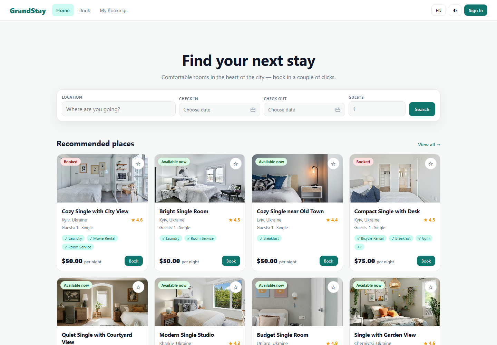 |
| Каталог номерів | 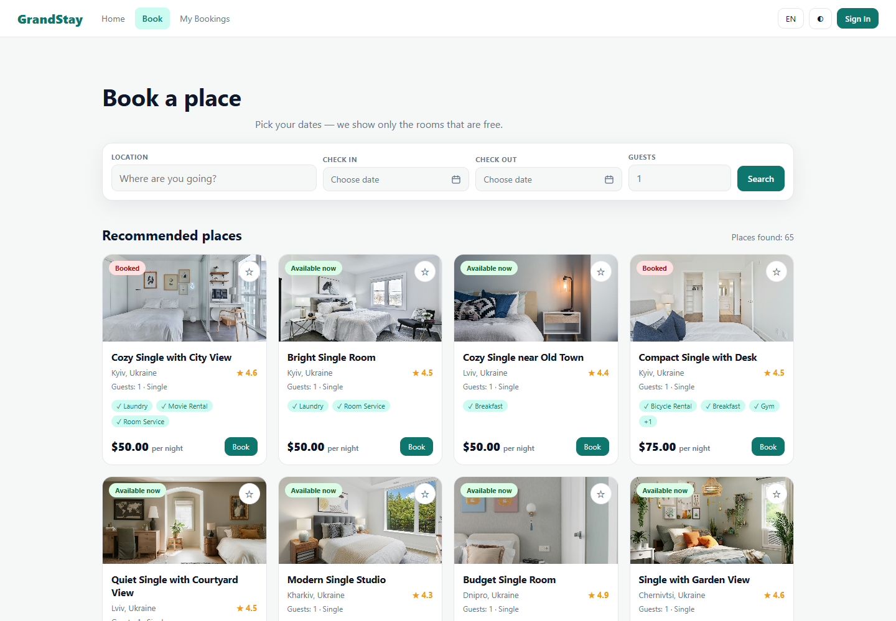 |
| Номер 101 | 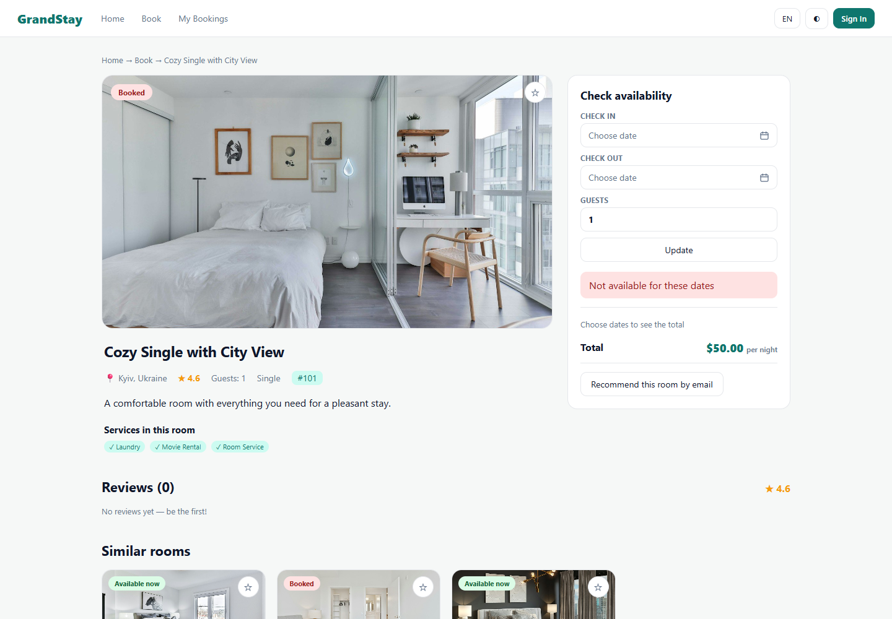 |

Знімки отримано автоматизованим браузером із публічних сторінок; приватні
сторінки та облікові дані користувачів у них не включені.

Типовий сценарій: **гість шукає й бронює номер онлайн, адміністратор доводить
бронювання до виїзду** — заселення → додаткові послуги → оплата → виселення;
далі — перевірка мови/теми та прав доступу за ролями. Усі кадри знято в
англійській локалізації (`$`), окрім кадра **19** — українська (`₴`) і темна
тема. База даних — чистий демонстраційний набір: 5 номерів, 13 додаткових
послуг, суперкористувач `manager`.

## Крок 1. Анонім: пошук вільного номера

1. Головна `/`: hero «Find your next stay», панель пошуку (Location /
   Check in / Check out / Guests) і добірка всіх номерів
   «Recommended places»; у шапці — Home / Book / My Bookings, перемикачі
   мови та теми, «Sign In».

   _Скрін 01:_

   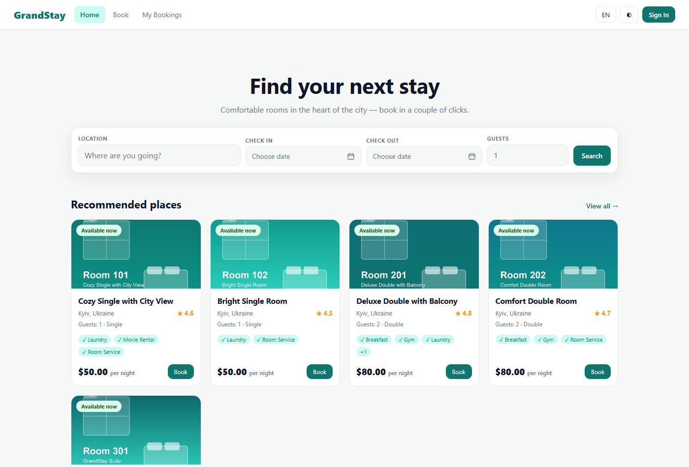

2. Клік по полю дати відкриває власний календар `cal.js`: місяць
   (листопад 2026 після навігації ‹ ›), підказка «Select check-in date»,
   кнопки «Today» і «Clear».

   _Скрін 01b:_

   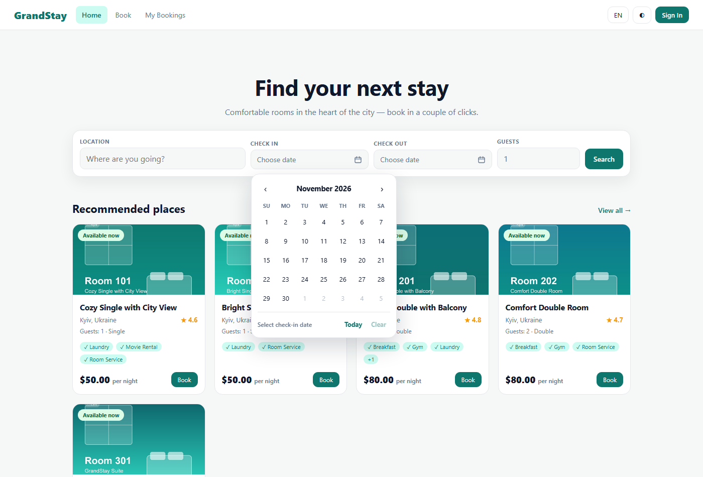

   Два кліки задають діапазон **01.11.2026 → 04.11.2026** (підказка
   стає «3 nights»), у тригерах — «Nov 1, 2026» і «Nov 4, 2026».

3. Пошук → `/places/`: заголовок «Book a place», підказка «Pick your
   dates — we show only the rooms that are free.», чип із діапазоном,
   лічильник «Places found: 5»; на всіх картках — бейдж
   «Free for your dates» (нічого не зайнято).

   _Скрін 02:_

   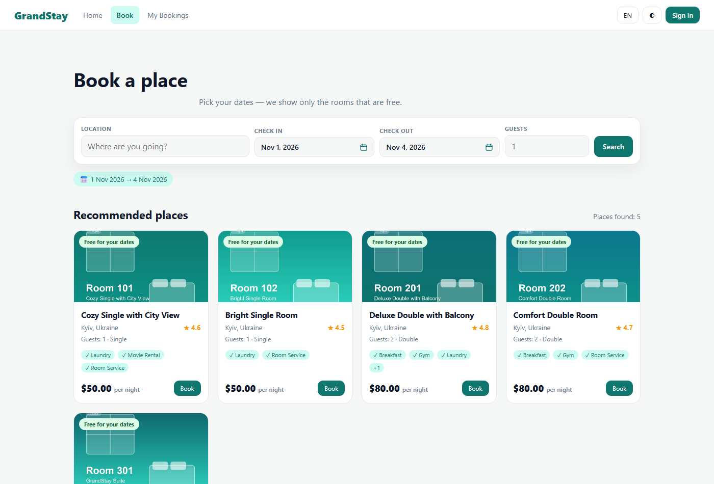

## Крок 2. Сторінка номера: ціна, наявність, місткість

1. `/places/201/`: хлібні крихти Home → Book → назва, фото-герой
   «Room 201», чипи (локалізація, рейтинг, місткість, тип, `#201`),
   опис і блок «Services in this room». Праворуч — «Check availability»
   із датами, підставленими з пошуку, зелений статус
   «✓ Available for these dates» і чек за 3 ночі:

   | Розрахунок | Сума |
   |---|---|
   | `$80.00 × 3 NIGHTS` | **$240.00** |
   | `Service fee (12%)` | **$29.00** |
   | `Total` | **$269.00** |

   Кнопка підсумовує бронювання: **«Book · $269»** (підказка — «You will
   confirm the booking on the next step»).

   _Скрін 03:_

   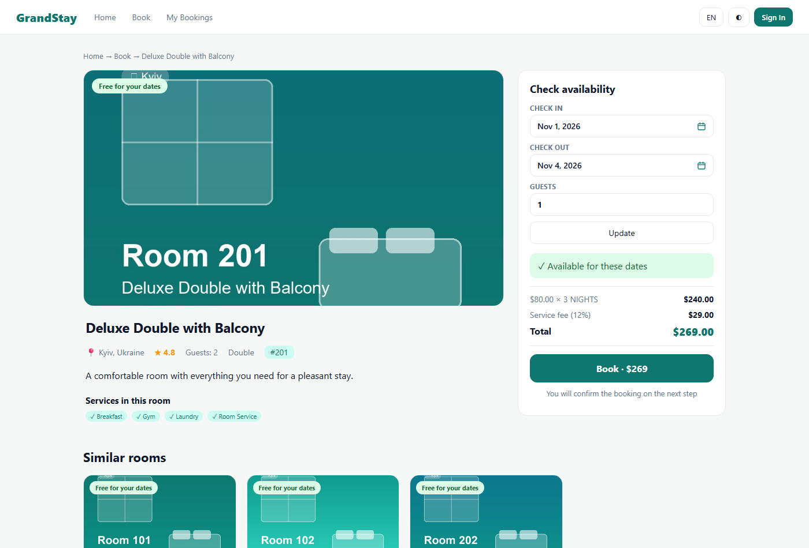

2. Негатив — місткість: `/places/101/?…&guests=4` для типу Single
   (ліміт 1) → червоне **«Too many guests for this room — Guests: 1»**,
   кнопки `Book` немає, розрахунок лишається лише для довідки
   ($50 × 3 ніччі + $18 = $168). Правила місткості: Single → 1,
   Double → 2, Suite → до 8 гостей.

   _Скрін 04:_

   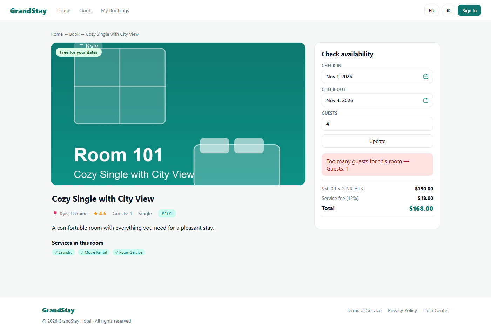

## Крок 3. Реєстрація та вхід гостя

1. `/register/` — картка «Create Account»: `maria`,
   `maria@test.com`, пароль двічі → кнопка «Register».

   _Скрін 05:_

   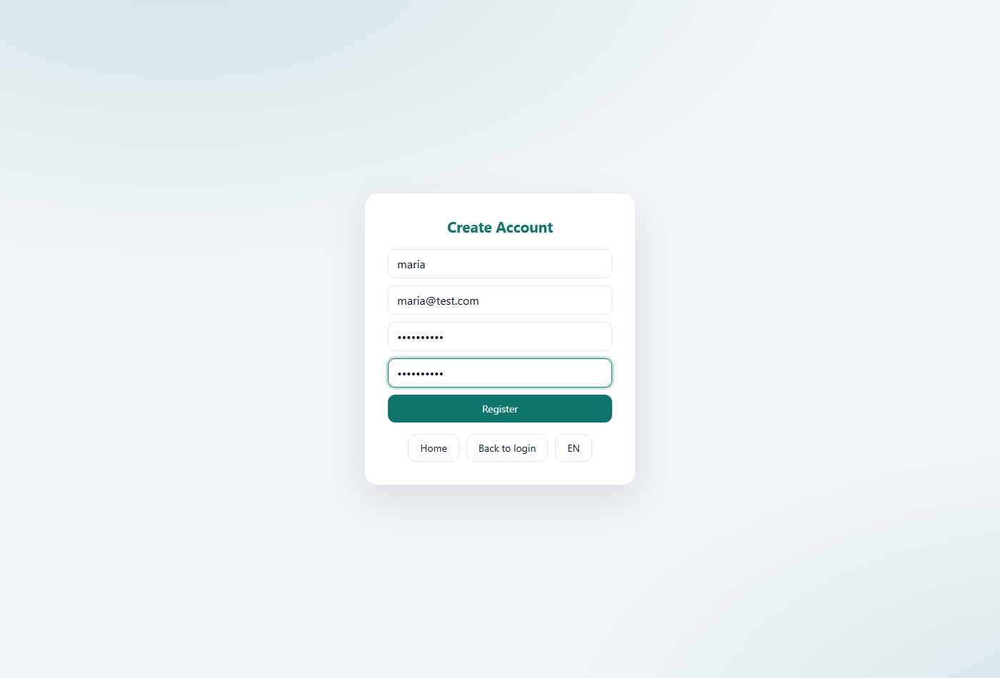

2. Після реєстрації — редирект на `/login/` із зеленим
   **«Registration successful»**; вхід `maria` → редирект у профіль.

   _Скрін 06:_

   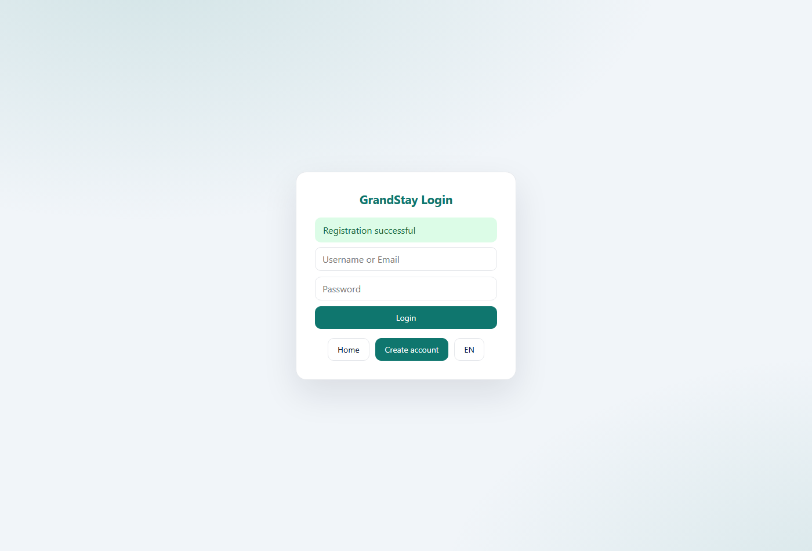

## Крок 4. Бронювання гостем

1. Зі сторінки місця (кнопка `Book`) гість потрапляє на
   `/reservations/?room=201&check_in=2026-11-01&check_out=2026-11-04`:
   форма «Book a Room» уже містить номер **«201 — Double ($80.00)»**,
   дати Nov 1 / Nov 4 та email з профілю `maria@test.com` — лише
   ім’я (`Maria Koval`) і телефон (`+380 671234567`) вводяться вручну.
   Список поки порожній — «No reservations yet».

   _Скрін 07:_

   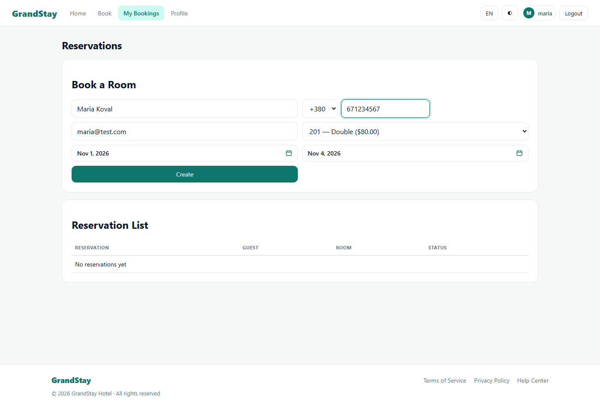

2. `Create` → **«Reservation created»**; у «Reservation List» — рядок
   `#1 · Maria Koval · 2026-11-01 → 2026-11-04 · 201 · Pending`.
   Номер **201 одразу стає Occupied** (звідси 20% зайнятості на кроці 5);
   у шапці з’являються Profile, ім’я користувача та Logout.

   _Скрін 08:_

   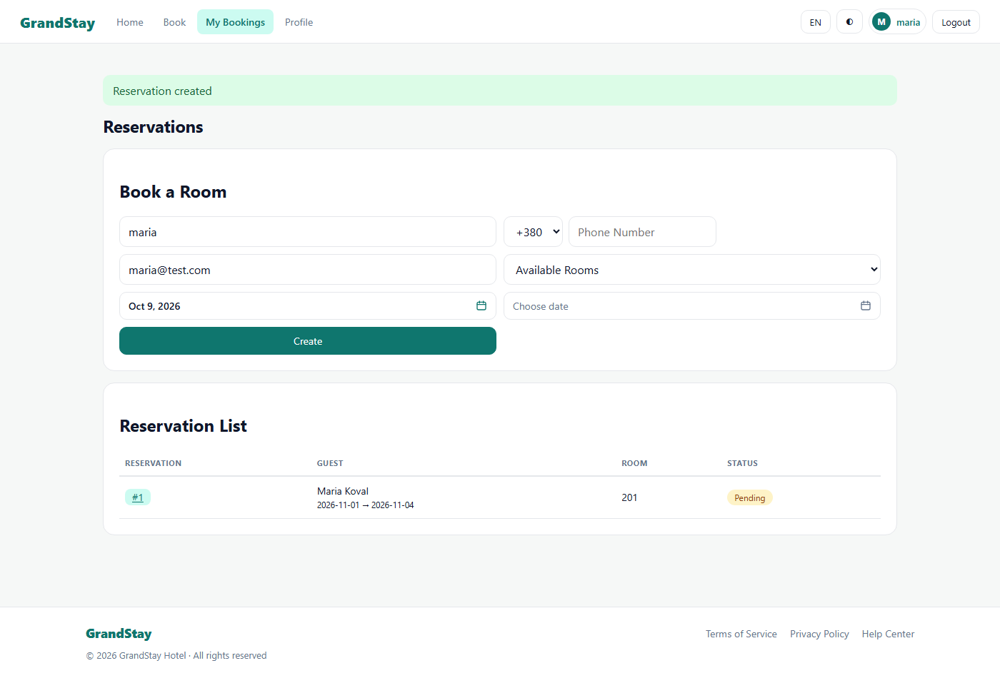

## Крок 5. Дашборд адміністратора

Вхід `manager` → `/dashboard/` (у шапці Home / Book / Dashboard / Rooms /
Reservations / Guests / Profile). KPI після бронювання:

- **OCCUPANCY 20%** — «1 of 5 rooms occupied» (201 зайнятий);
- **AVAILABLE ROOMS 4**;
- **ARRIVALS TODAY 1** — активне бронювання Pending;
- **TOTAL REVENUE $240** — «Rooms $240 · Services $0».

У «Recent Reservations» — `Maria Koval | 201 | 2026-11-01 | Pending |
$240.00`; «Room Status» малює 201 синім (Occupied), решту — зеленими;
«Services Revenue» — «No service orders yet.».

_Скрін 09:_

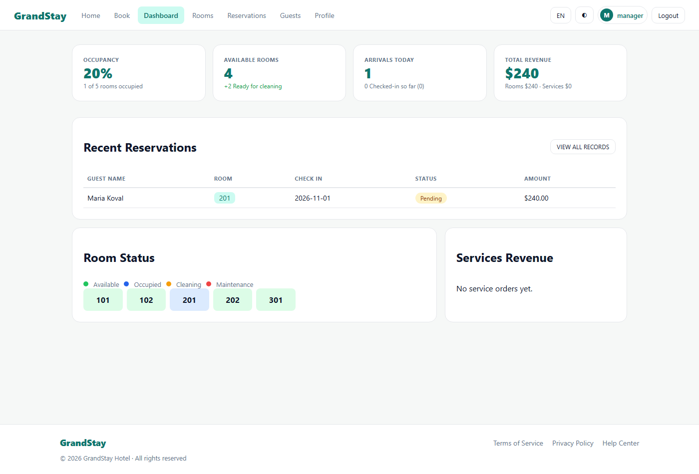

## Крок 6. Заселення та накладання дат

1. `/reservations/` — адмін-форма «Create Reservation» над списком
   «Reservation List»; у рядку бронювання — селект статусу і «Save».

   _Скрін 10:_

   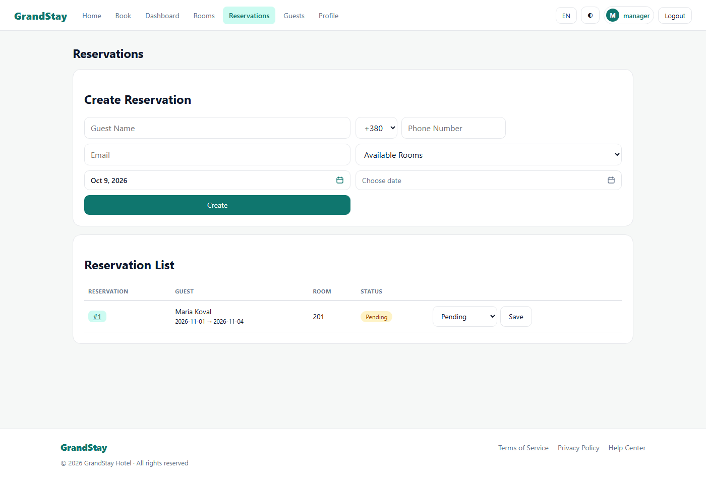

2. `Pending → Checked-In` → **«Reservation 1 updated»**, бейдж
   «Checked-In» (номер у статусі Occupied, заселення зафіксовано).

   _Скрін 11:_

   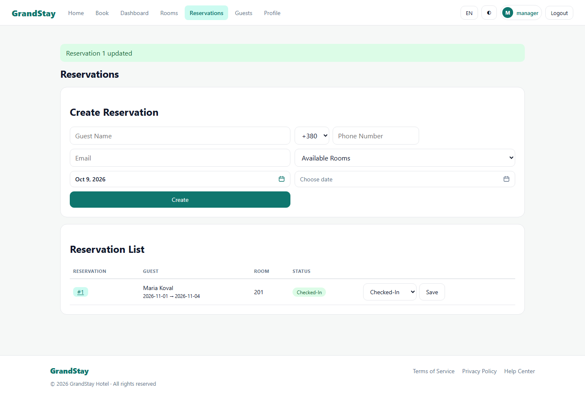

3. Негатив — накладання дат: спроба створити ще одне бронювання на 201
   у ті самі ночі (01–04.11) → червоне
   **«This room is already booked for the selected dates»**
   (перевірка перетину інтервалів у `Reservation.clean()`; сусідні дати —
   заїзд у день виїзду — дозволені). Нічого не зберігається: запис гостя
   «Walk-in Guest» відкочується, форму очищено.

   _Скрін 12:_

   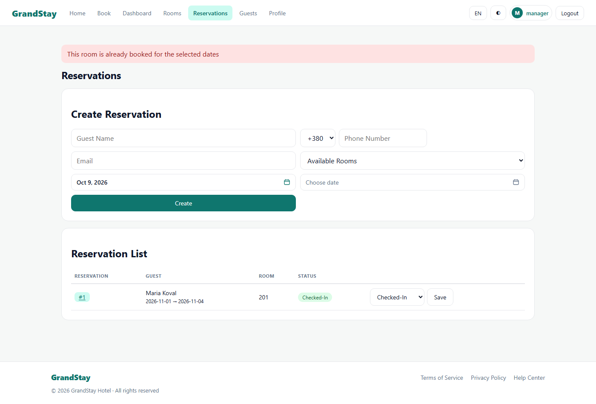

## Крок 7. Додаткові послуги на сторінці бронювання

1. `/reservations/1/` — «Booking details #1» з бейджем статусу: ліворуч
   «Stay» (номер, назва, гість, дати, 3 ночі, 1 гість) і «Bill»
   ($240.00 + $29.00 = **$269.00**), праворуч — «Extra services»
   із каталогом «Order extra services». Відмічено **Breakfast ×2** і
   **Spa ×1**, кнопка «Add services».

   _Скрін 13:_

   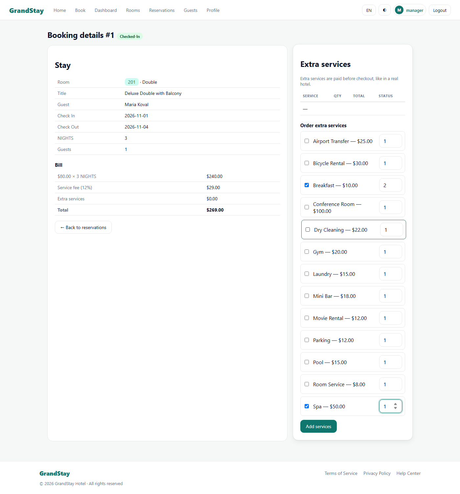

2. `Add services` → **«Services ordered»**: у таблиці — `Spa 1 $50.00`
   і `Breakfast 2 $20.00` у статусі **Unpaid**, підсумок
   «To pay before checkout: **$70.00**» і кнопка
   «Pay before checkout · $70»; у «Bill» додається рядок
   `Extra services $70.00` → **Total $339.00**.

   _Скрін 14:_

   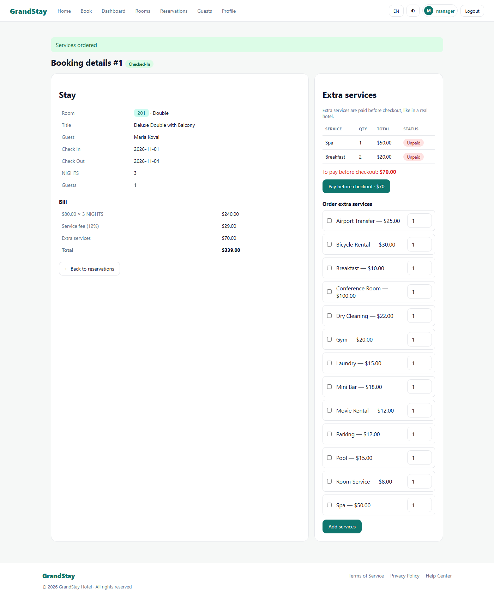

## Крок 8. Оплата перед виселенням

1. Негатив — виселення до оплати: `Checked-Out` у списку → червоне
   **«Pay the extras before checkout»**; статус бронювання лишається
   `Checked-In`, поки є неоплачені послуги (`extras_due > 0`).

   _Скрін 15:_

   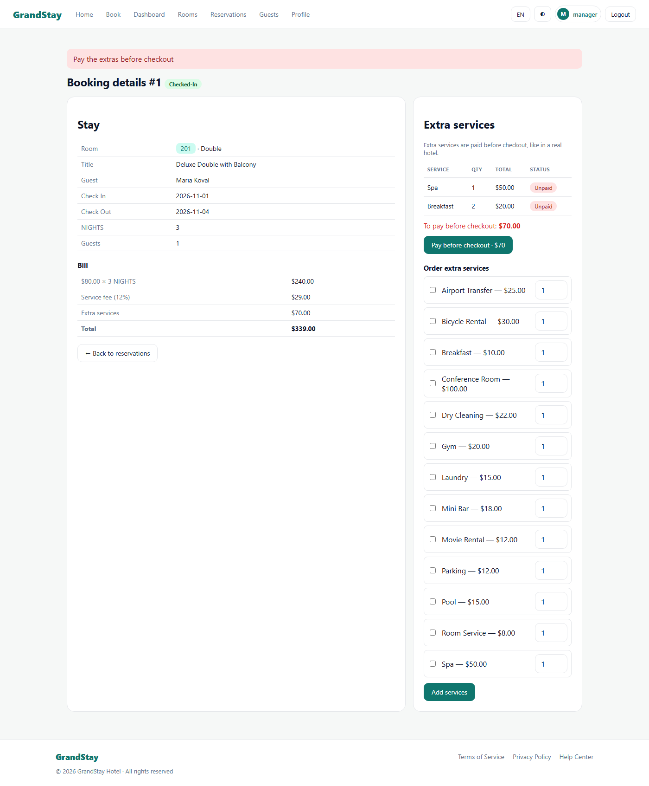

2. Кнопка «Pay before checkout» → **«Payment successful»**: обидві
   позиції стають **Paid**, блок «To pay…» і кнопка оплати зникають,
   у «Bill» — Total $339.00.

   _Скрін 16:_

   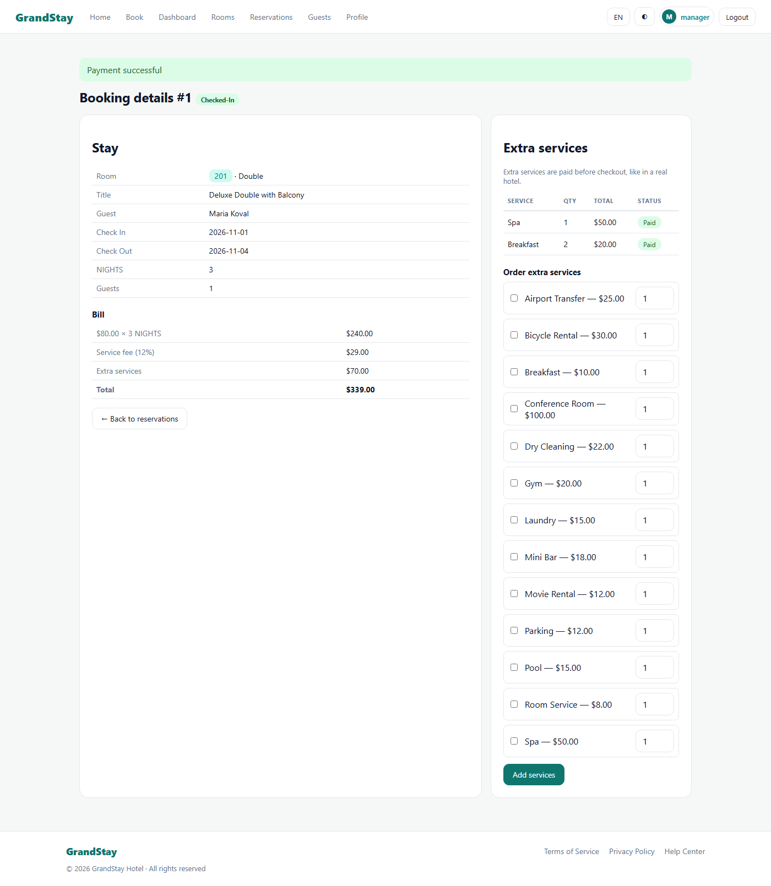

3. Повторний `Checked-Out` → **«Reservation 1 updated»**, бейдж
   «Checked-Out»; номер 201 повертається у `Available`.

   _Скрін 17:_

   

## Крок 9. Захист видалення номера

`/rooms/`: форма «Delete Room» → вказати `201` → **«Cannot delete room
201 — it has active reservations»** — номер із бронюваннями не
видаляється; редагування та додавання інших номерів лишаються доступними.

_Скрін 18:_

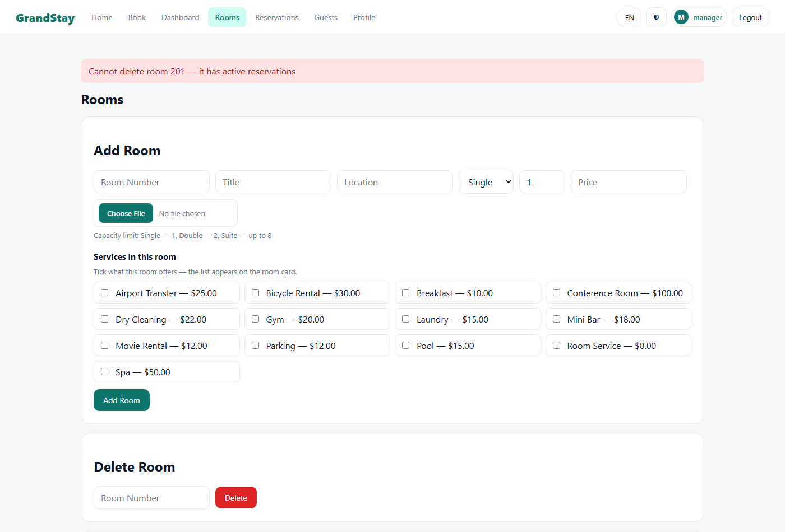

## Крок 10. Українська мова і темна тема

Перемикачі у шапці (`EN → UK`, `◐ → темна`): той самий дашборд українською
і в темній темі (`data-theme="dark"`, `lang="uk"`), гроші — в гривні
за курсом **44.78** (тег `` + `currency.py`):

- **ЗАЙНЯТІСТЬ 0%** — «0 з 5 номерів зайнято» (після виселення);
- **ВІЛЬНІ НОМЕРИ 5**;
- **ПРИБУТТЯ СЬОГОДНІ 0**;
- **ЗАГАЛЬНИЙ ДОХІД ₴13,882** = «Номери ₴10,747 · Послуги ₴3,135»
  ($240 + $70 = $310 × 44.78);
- «Останні бронювання»: `Maria Koval | 201 | 2026-11-01 | Виселений |
  ₴10,747.20`; легенда «Вільний / Зайнятий / Прибирання / Обслуговування».

_Скрін 19:_

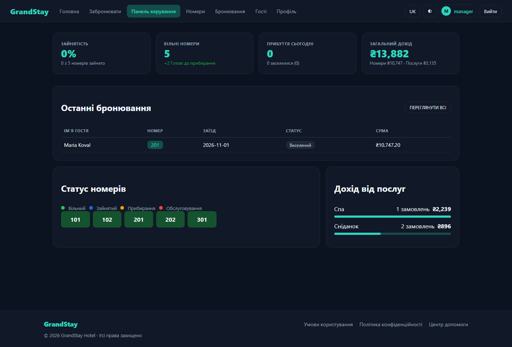

## Крок 11. Профіль та ролі

1. Профіль адміністратора `/profile/`: картка «My Account» (юзернейм,
   email, Role — Administrator, дата реєстрації, останній вхід, мова,
   тема), форми «Update Email» і «Change Password», панель
   «My Statistics» і таблиця «Recent Reservations».

   _Скрін 20:_

   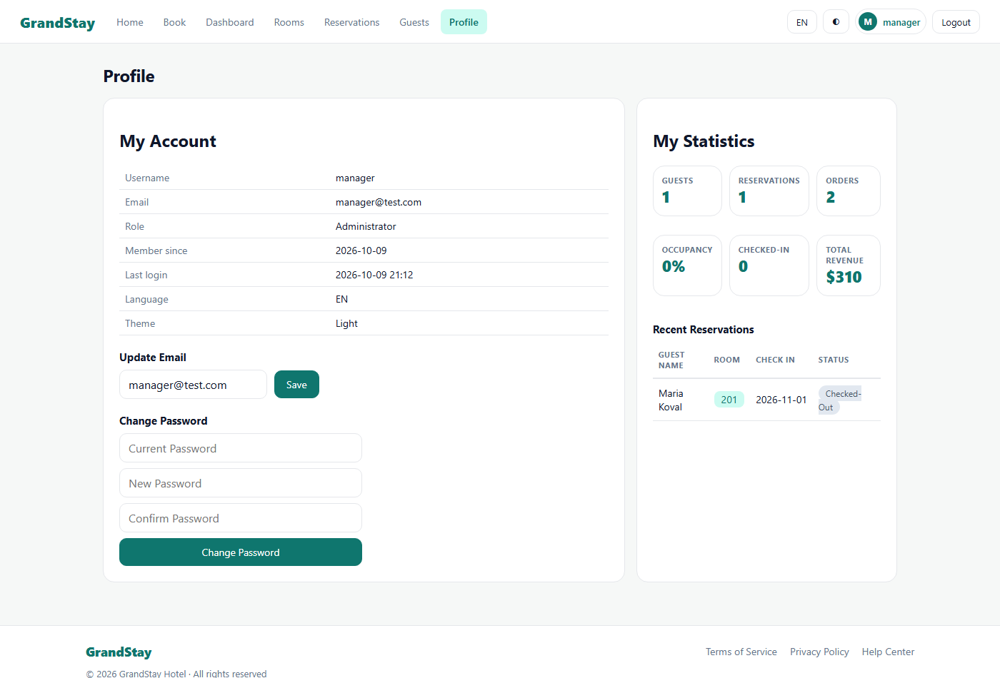

2. Звичайний користувач `maria` (роль User): `/reservations/` показує
   **лише власне** бронювання («My Bookings»), а в шапці — тільки
   Home / Book / My Bookings / Profile: пунктів Dashboard, Rooms,
   Guests немає.

   _Скрін 21:_

   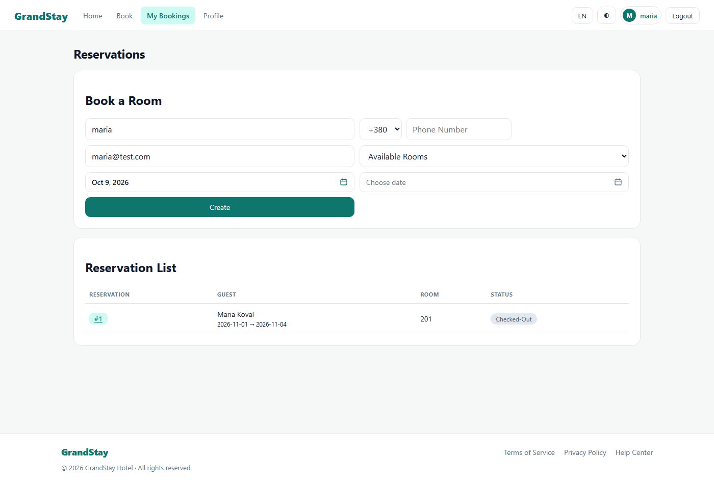

3. Спроба відкрити `/dashboard/` → редирект назад у профіль із червоним
   **«Access restricted to administrators»** («Доступ лише для
   адміністраторів»). Анонімний запит адмін-сторінки взагалі
   відповідає `302 → /login/` (перевірено тестами).

   _Скрін 22:_

   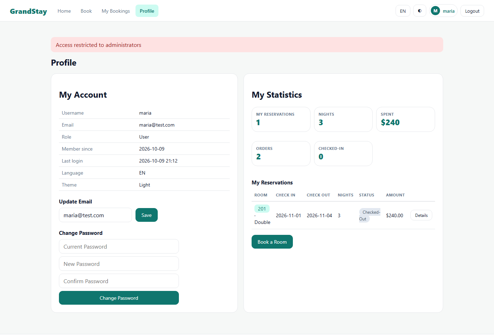

## Висновок прикладу

Усі 11 кроків (23 кадри) виконуються без помилок; помилки в консолі
браузера відсутні. Негативні перевірки спрацьовують точними повідомленнями:
місткість гостей (04), накладання дат (12), виселення до оплати (15),
видалення номера з бронюваннями (18), права ролей (22). Математика
збігається з ручним розрахунком: $80 × 3 = $240 + 12% ($29) = $269 на
етапі бронювання, + $70 послуг = $339 після замовлення; дохід дашборда
після сценарію — $310 → ₴13,882, зайнятість 20% → 0%. Мова й тема
перемикаються глобально, суми перераховуються (EN → `$`, UK → `₴`),
а звичайний користувач реально бачить лише власні дані.

> Скріни знято автоматизованим скриптом (Playwright) на окремому екземплярі
> `runserver` із чистою базою даних (міграції + `01_schema/02_seed`,
> `03_more_rooms` не застосовувався): 23 послідовні кадри за цим сценарієм —
> гість `maria`, адміністратор `manager`, дати 2026-11-01…2026-11-04,
> мова EN і світла тема, окрім кадра 19 (UK + темна тема) →
> `screenshots/`.
